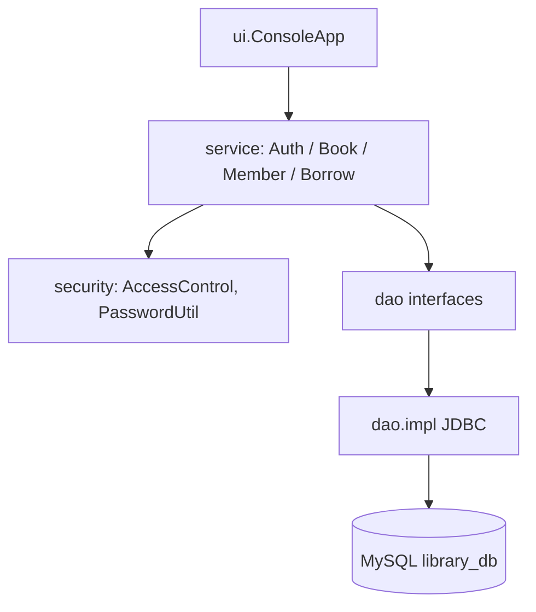
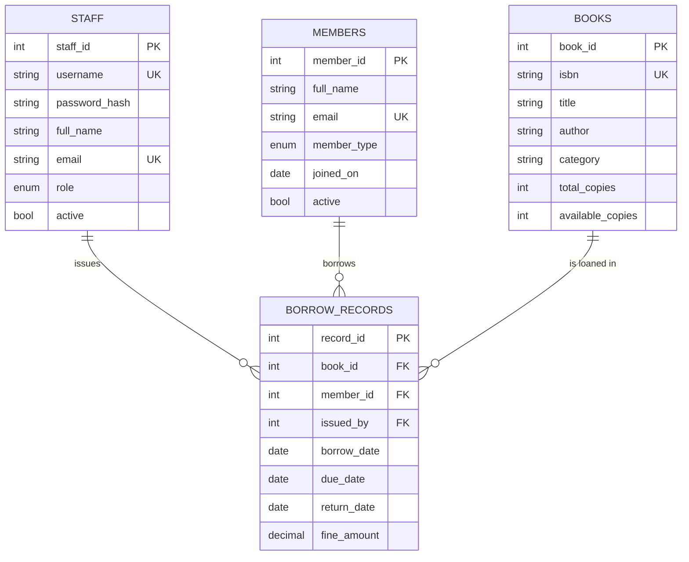
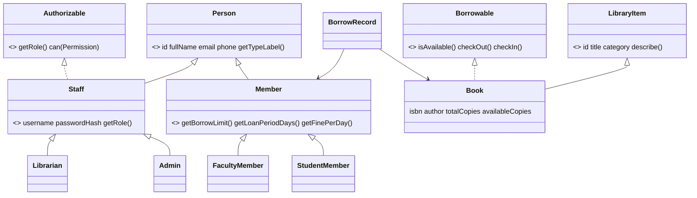

# Design

## Architecture
Layered architecture; each layer only talks to the one below it.

Design choices:
- **DAO pattern** - SQL is isolated in `dao.impl`; services depend on interfaces, so tests inject in-memory fakes.
- **Strategy pattern** - `FinePolicy` lets the fine rule change without touching `BorrowService`.
- **Factory methods** - `Member.create(...)` and `Staff.create(...)` build the correct subclass from a database value.
- **Exceptions** - a single `LibraryException` hierarchy; JDBC `SQLException`s are wrapped in `DataAccessException`.
- **Atomic circulation** - `UPDATE books SET available_copies = available_copies - 1 ... WHERE available_copies > 0` plus the loan insert run in one transaction.

## Entity-relationship diagram

## Class diagram (entities)

## Issue-book flow
1. Check the staff member has `ISSUE_RETURN`.
2. Load the member (must be active) and the book (must have a copy).
3. Reject duplicates, overdue loans and borrow-limit breaches.
4. Compute the due date from the membership type.
5. `BorrowDao.issue` decrements stock and inserts the loan in one transaction.
